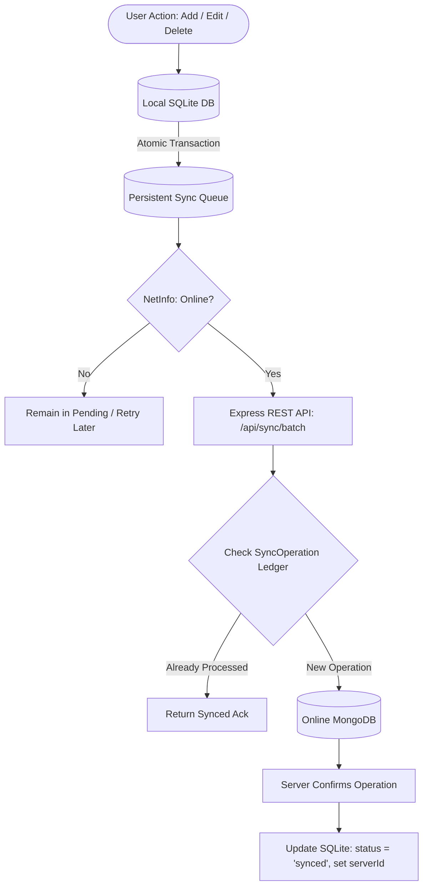

# Offline-First Data Synchronization Demo App (React Native CLI + SQLite + Node.js + MongoDB)

A production-grade, offline-first mobile application built with **React Native CLI**, **SQLite (`@op-engineering/op-sqlite`)**, **`@react-native-community/netinfo`**, **Node.js/Express REST API**, and **MongoDB with Mongoose**.

---

## 🎯 Architecture Overview



### The Offline-First Rule:
> **LOCAL DATABASE FIRST ➔ PENDING OPERATION QUEUE ➔ REST API ➔ MONGODB ➔ SERVER ACKNOWLEDGEMENT ➔ LOCAL SYNC STATUS UPDATE**

1. **Immediate Local Persistence:** Every product creation, modification, or deletion is recorded inside an atomic SQLite transaction alongside its queued operation.
2. **Instant UI Response:** The user never waits for network requests or server round-trips.
3. **Guaranteed Delivery & Idempotency:** Every queued mutation is assigned a stable client UUID (`operationId`). Retries or retransmissions will never create duplicate MongoDB entries.
4. **Resilient Sync Engine:** Monitors network transitions automatically and supports manual "Sync Now" triggers with exponential backoff and error logging.

---

## 📱 Features

- **Product Inventory Management:**
  - Add, Edit, Soft-delete, and View products offline and online.
  - Search by product name or description.
  - Filter by sync status (`All`, `Pending`, `Synced`, `Failed`).
- **Dashboard & Diagnostics:**
  - Live counters for Total, Synced, Pending, and Failed records.
  - Real-time device network connection and API server health status.
  - Last successful synchronization timestamp.
  - One-tap manual **"Sync Now"** trigger.
- **Sync Activity & Inspection:**
  - Visual log of all queued sync operations.
  - Detailed error reasons, attempt counts, and retry timestamps.
  - One-tap **"Retry All Failed"** and single-operation retry controls.
- **Dynamic Server Configuration:**
  - Fast switching between Android Emulator (`10.0.2.2:5000`), Physical Phone (LAN IP), and Localhost.
  - Live server ping test measuring latency and reporting online MongoDB connectivity.

---

## 🛠️ Technology Stack

| Layer | Technology | Purpose |
| :--- | :--- | :--- |
| **Mobile Frontend** | React Native CLI (`0.87.1`), React 19 | High-performance mobile client |
| **Local Database** | `@op-engineering/op-sqlite` (`18.2.5`) | Ultra-fast local SQLite engine |
| **Connectivity** | `@react-native-community/netinfo` (`12.0.1`) | Network & reconnect monitoring |
| **Backend Server** | Node.js, Express.js | REST API & Batch sync engine |
| **Cloud Database** | MongoDB & Mongoose (`8.9.5`) | Online data persistence & Idempotency ledger |

---

## 📂 Project Structure

```text
OfflineSyncDemo/
├── src/
│   ├── components/
│   │   ├── NetworkStatusBanner.js   # Real-time offline and server status banner
│   │   ├── ProductCard.js           # Interactive product card with status badges
│   │   └── SyncStatusBadge.js       # Synced / Pending / Syncing / Failed badges
│   ├── database/
│   │   ├── database.js              # SQLite connection & transaction executor
│   │   ├── migrations.js            # Schema setup: 'products' & 'sync_queue'
│   │   ├── productRepository.js     # Parameterized product CRUD operations
│   │   ├── syncQueueRepository.js   # Persistent queue query layer
│   │   └── index.js                 # Database entry point
│   ├── screens/
│   │   ├── HomeScreen.js            # Dashboard with counters and Sync Now
│   │   ├── ProductListScreen.js     # Search, filter pills, and product list
│   │   ├── AddProductScreen.js      # Input form with client validation
│   │   ├── EditProductScreen.js     # Product update form
│   │   ├── ProductDetailsScreen.js  # Technical IDs, timestamps, and delete
│   │   ├── SyncActivityScreen.js    # Operations queue inspection & retry
│   │   └── SettingsScreen.js        # API endpoint selector & latency test
│   ├── services/
│   │   ├── api.js                   # REST API client with timeout protection
│   │   ├── networkService.js        # NetInfo event subscriptions
│   │   └── syncService.js           # Core sync engine (mutex, auto-sync, retries)
│   ├── theme/
│   │   └── colors.js                # Accessible design tokens
│   └── utils/
│       ├── uuid.js                  # RFC4122 v4 UUID generator
│       └── validation.js            # Client-side input validation
├── backend/
│   ├── src/
│   │   ├── config/database.js       # Mongoose connection manager
│   │   ├── controllers/
│   │   │   ├── productController.js # REST CRUD handlers
│   │   │   └── syncController.js    # Idempotent batch sync handler
│   │   ├── models/
│   │   │   ├── Product.js           # MongoDB product model (with localId)
│   │   │   └── SyncOperation.js     # Idempotency ledger
│   │   ├── routes/
│   │   │   ├── healthRoutes.js      # GET /api/health
│   │   │   ├── productRoutes.js     # /api/products
│   │   │   └── syncRoutes.js        # POST /api/sync/batch
│   │   ├── app.js                   # Express configuration
│   │   └── server.js                # Server entry point (binds to 0.0.0.0)
│   ├── test-sync.js                 # Automated API test suite
│   ├── .env                         # Environment variables
│   └── package.json                 # Backend dependencies
├── App.tsx                          # Application bootstrap & navigation
└── package.json                     # Mobile app dependencies
```

---

## 🚀 Setup & Installation Instructions

### 1. Prerequisites
- Node.js `v20+` or `v24+` installed.
- Android Studio with Android SDK and an Android Virtual Device (AVD) or physical Android device.
- MongoDB (running locally on port 27017 or a free cloud [MongoDB Atlas](https://www.mongodb.com/atlas) URI).

---

### 2. Backend Setup
1. Open a terminal and navigate to the backend folder:
   ```bash
   cd backend
   ```
2. Check or edit the `.env` file:
   ```env
   PORT=5000
   HOST=0.0.0.0
   NODE_ENV=development
   MONGODB_URI=mongodb://127.0.0.1:27017/offline_sync_demo
   ```
   *(If using MongoDB Atlas, replace `MONGODB_URI` with your connection string: `mongodb+srv://<user>:<password>@cluster.mongodb.net/offline_sync_demo`)*

3. Start the backend server:
   ```bash
   npm start
   ```
   *(Or run with hot-reload: `npm run dev`)*

4. Verify server health in your browser or terminal:
   ```bash
   curl http://localhost:5000/api/health
   ```

---

### 3. Mobile App Setup
1. In the root directory, ensure packages are installed:
   ```bash
   npm install
   ```
2. Start the Metro bundler:
   ```bash
   npm start
   ```
3. In a separate terminal, launch the Android app:
   ```bash
   npm run android
   ```

---

## 🌐 Network Configuration Guide

### Scenario 1: Android Emulator
- **URL to use:** `http://10.0.2.2:5000`
- **Why?** The Android emulator runs in an isolated virtual network where `localhost` or `127.0.0.1` refers to the emulator itself. `10.0.2.2` is the special virtual router alias provided by Android to communicate with your host development computer.

### Scenario 2: Physical Android Device (Wi-Fi)
1. Connect your computer and your Android phone to the **same Wi-Fi network**.
2. Find your computer's local LAN IP:
   - **Windows:** Run `ipconfig` (look for *IPv4 Address*, e.g., `192.168.1.25`).
3. Open the app, go to **Settings (⚙️)**, and set the URL to:
   ```text
   http://192.168.1.25:5000
   ```
4. Tap **"⚡ Ping Server"** to confirm connectivity.

### Cleartext Traffic Note:
Android blocks unencrypted HTTP traffic by default in production. This project configures `android:usesCleartextTraffic="${usesCleartextTraffic}"` in [AndroidManifest.xml](file:///c:/Users/RAHUL/Desktop/Main/OfflineSyncDemo/android/app/src/main/AndroidManifest.xml), allowing HTTP for local development while preserving HTTPS requirements in release builds.

---

## 🧪 Comprehensive Testing Scenarios (Tests A – H)

Follow these exact steps to demonstrate and verify all requirements:

### Test A: Offline Create
1. Put the Android device/emulator into **Airplane Mode** (or disable Wi-Fi/data).
2. The top banner will immediately show: **"Offline Mode — Changes saved locally in SQLite"**.
3. Tap **"+ Add New Product"** and create:
   - Name: `Offline Headset`
   - Price: `1499`
   - Quantity: `5`
4. Tap **"Save Product"**.
5. Observe: The product appears in the Product List with an **Amber "Pending"** badge.
6. **Force close the application completely and restart it.**
7. Verify: `Offline Headset` is still present, loaded directly from SQLite, and marked as **"Pending"**.

### Test B: Automatic Sync on Reconnection
1. Keep the app open and turn **Airplane Mode OFF** (restore internet).
2. The app detects connectivity via `@react-native-community/netinfo` and automatically triggers `syncNow()`.
3. Notice the badge change: **"Pending" ➔ "Syncing" ➔ "Synced" (Emerald Green)**.
4. Go to MongoDB and query the `products` collection:
   ```javascript
   db.products.find({ name: "Offline Headset" })
   ```
5. Confirm the MongoDB record exists with matching `localId`.

### Test C: API Server Unavailable
1. Keep the phone connected to Wi-Fi, but **stop the Node.js backend server** (`Ctrl + C` in the backend terminal).
2. In the mobile app, tap **"+ Add New Product"** and add another product.
3. The app saves the product locally to SQLite immediately.
4. The top banner indicates: **"Backend Server Unreachable — Retrying automatically"**.
5. Restart the Node.js server (`npm start`).
6. Tap **"Sync Now"** (or wait for the automatic health poll). The pending operation synchronizes smoothly!

### Test D: Duplicate Prevention (Idempotency)
1. Go to the **Sync Logs** tab.
2. Select any operation and tap **"Retry"** even if already synced.
3. The server receives the same `operationId`, detects it in the `SyncOperation` collection, and returns a success acknowledgement without creating a duplicate record in MongoDB.

### Test E: Offline Edit and Delete
1. Turn off internet (Offline).
2. Edit `Offline Headset` (change price to `1999`).
   - The product is updated in SQLite and an `update` operation is queued.
3. Delete another product:
   - A confirmation dialog appears.
   - Upon confirming, the product is soft-deleted locally (`isDeleted = 1`) and a `delete` operation is queued.
4. Turn on internet:
   - Both operations are submitted in a batch.
   - MongoDB updates the modified product and soft-deletes the removed product.
   - The local SQLite store cleans up the deleted record.

### Test F: Partial Batch Failure Resilience
1. If a batch contains 3 operations where one has invalid parameters, the backend processes operations individually:
   - Valid operations are marked **"Synced"**.
   - Invalid operations are marked **"Failed"** with the error recorded in the `sync_queue`.
   - The app does NOT discard or rollback the successful operations!

### Test G: Network Transition
1. Rapidly toggle Wi-Fi / Airplane mode on and off.
2. The `isSyncing` mutex lock ensures that only **one sync worker** runs at a time, avoiding duplicate concurrent sync loops.

### Test H: Conflict Handling Policy
- **Policy:** Last-Write-Wins based on client `updatedAt` vs server `updatedAt` with atomic version numbering (`version`).
- If an update arrives for an entity where the server has a newer modification, the server records the conflict and preserves current state without silent data loss.

---

## 📡 REST API Reference

| Method | Endpoint | Description |
| :--- | :--- | :--- |
| `GET` | `/api/health` | Health check, uptime, and MongoDB status |
| `GET` | `/api/products` | Retrieve products (supports `?search=&page=&limit=`) |
| `GET` | `/api/products/:id` | Get single product by MongoDB `_id` or `localId` |
| `POST` | `/api/products` | Create product directly via REST |
| `PUT` | `/api/products/:id` | Update product directly via REST |
| `DELETE` | `/api/products/:id` | Soft-delete product |
| `POST` | `/api/sync/batch` | Bulk sync endpoint processing queued client operations |

### Sample Batch Sync Request Payload:
```json
{
  "operations": [
    {
      "operationId": "e1f2a3b4-5678-4abc-9def-1234567890ab",
      "entityId": "a9b8c7d6-1234-4567-89ab-cdef01234567",
      "operationType": "create",
      "payload": {
        "localId": "a9b8c7d6-1234-4567-89ab-cdef01234567",
        "name": "Wireless Mechanical Keyboard",
        "price": 3499,
        "quantity": 12,
        "description": "RGB backlight with hot-swappable switches",
        "createdAt": "2026-10-14T10:00:00.000Z",
        "updatedAt": "2026-10-14T10:00:00.000Z"
      }
    }
  ]
}
```

### Sample Batch Sync Response:
```json
{
  "success": true,
  "totalCount": 1,
  "successCount": 1,
  "failureCount": 0,
  "results": [
    {
      "operationId": "e1f2a3b4-5678-4abc-9def-1234567890ab",
      "entityId": "a9b8c7d6-1234-4567-89ab-cdef01234567",
      "status": "synced",
      "serverId": "670cde5a1b2c3d4e5f6a7b8c",
      "message": "Product created successfully"
    }
  ]
}
```

---

## 🔒 Security Best Practices
- **No Client Credentials:** Database connection strings are never bundled with or accessible from the mobile app.
- **Input Validation:** Products and operations are strictly validated on both client (JavaScript) and server (Mongoose schemas).
- **Graceful Error Handling:** Server errors return clean, predictable JSON responses without leaking environment or system internals.
