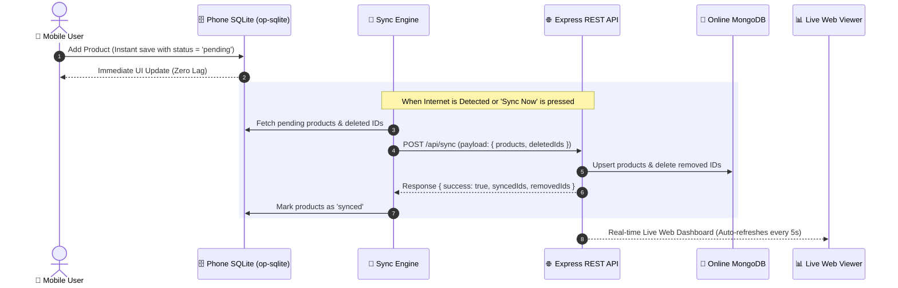

# ⚡ OfflineSyncPro — Offline-First Data Synchronization Demo

[](https://reactnative.dev/)
[](https://github.com/OP-Engineering/op-sqlite)
[](https://nodejs.org/)
[](https://expressjs.com/)
[](https://www.mongodb.com/)
[](LICENSE)

A clean, production-grade **Offline-First mobile application** built using **React Native CLI**, high-performance local **SQLite (`@op-engineering/op-sqlite`)**, **`@react-native-community/netinfo`**, and a **Node.js + Express + MongoDB** backend with a real-time web dashboard.

---

## 💡 What is Offline-First?

In traditional mobile apps, when a user adds or edits data without internet, the app fails with an error or spins indefinitely. 

In an **Offline-First Architecture**:
1. **Local Database First:** Every action (Add, View, Delete) is saved **instantly** into the phone's local SQLite database. The user never experiences loading spinners or network lag.
2. **Background Sync:** The app actively monitors internet connectivity. As soon as the device connects to Wi-Fi or mobile data, queued changes are automatically pushed to the cloud (MongoDB).
3. **Status Feedback:** Every item clearly displays its synchronization state (**`⏳ Pending`** vs **`✓ Synced`**).

---

## 🎯 Architecture & Data Flow



---

## ✨ Key Features

### 📱 Mobile App (React Native CLI)
- **Instant Local Storage:** Powered by `@op-engineering/op-sqlite` (high-performance native C++ SQLite bridge).
- **Network Awareness:** Real-time Online/Offline connection status pill using `@react-native-community/netinfo`.
- **Live Sync Dashboard:** Real-time counters showing **Total**, **✓ Synced**, and **⏳ Pending** items.
- **Interactive Filter Tabs:** Instant 1-tap filtering between `All`, `⏳ Pending`, and `✓ Synced`.
- **Automatic & Manual Sync:** Automatically triggers sync when Wi-Fi is restored, with a manual **"Sync Now ↻"** button.
- **Two-way Safe Deletion:** Native confirmation dialog before deletion; deletes from both local SQLite and MongoDB (even when deleted while offline).

### 🍃 Backend (Node.js + Express + MongoDB)
- **Zero-Setup Embedded Database:** Automatically launches an embedded MongoDB instance (`mongodb-memory-server`) if a local MongoDB service is not detected.
- **Idempotent Sync API:** `POST /api/sync` uses MongoDB `upsert` so network retries never create duplicate records.
- **Live Browser Dashboard (`/view`):** Open `http://localhost:5000/view` on any computer browser to watch synced records update in real time with auto-refresh every 5 seconds.

---

## 📁 Clean & Simple Project Structure

The codebase is organized into **4 primary files** designed to be easily understood and demonstrated:

```text
OfflineSyncDemo/
├── App.jsx                 # 📱 React Native UI (Header, Stats, Form, Cards, Filter tabs)
├── src/
│   ├── database.js         # 🗄️ SQLite Helper (initDB, addProduct, getProducts, deleteProduct)
│   └── syncService.js      # 🔄 Sync Logic (Network check, POST /api/sync, auto-sync listener)
└── backend/
    └── src/
        └── server.js       # 🌐 Express API Server + MongoDB models + Live /view HTML dashboard
```

---

## 🚀 Getting Started

### 1. Prerequisites
- **Node.js** 18+ installed
- **Android Studio** configured with Android SDK (API 34+) and ADB
- Real Android phone connected via USB/Wi-Fi or Android Emulator

---

### 2. Backend Setup
1. Open a new terminal in the project root:
   ```bash
   cd backend
   npm install
   npm start
   ```
2. The server will launch:
   ```text
   ====================================================
   🚀 BACKEND SERVER RUNNING AT: http://localhost:5000
   📊 BROWSER LIVE VIEWER:       http://localhost:5000/view
   📱 MOBILE API BASE URL:       http://192.168.1.39:5000
   ====================================================
   ```
3. Open **`http://localhost:5000/view`** in your browser to view the live dashboard.

---

### 3. Mobile App Setup
1. In another terminal in the project root:
   ```bash
   # Route phone's localhost port to computer (Required for physical devices connected via ADB)
   adb reverse tcp:5000 tcp:5000

   # Install dependencies
   npm install

   # Start Android App
   npm run android
   ```

---

## 🧪 Testing the Offline-First Experience

1. **Step 1: Test Instant Offline Creation**
   - Turn off Wi-Fi and Mobile Data on your phone.
   - The app's header status changes to **`🔴 Offline`**.
   - Add a product (e.g., *Wireless Keyboard*, *₹999*).
   - Notice the product saves **immediately** with a **`⏳ Pending`** badge.

2. **Step 2: Test Background Auto-Sync**
   - Turn on Wi-Fi on your phone.
   - The app detects internet and automatically pushes the item to MongoDB.
   - The badge instantly switches to **`✓ Synced`**!
   - Check `http://localhost:5000/view` in your browser — the product is live in MongoDB!

3. **Step 3: Test Safe Deletion**
   - Tap the 🗑️ icon on any product in the app.
   - A confirmation dialog appears: *"Are you sure you want to delete...?"*
   - Confirm delete. The product vanishes from the phone and is immediately removed from MongoDB.

---

## 🎤 Interview Cheat Sheet (How to Explain this Project)

| Question | Answer |
| :--- | :--- |
| **Why not save directly via REST API?** | Direct API saves freeze the UI on poor connections and completely fail offline. Storing in local SQLite first provides 0ms perceived latency. |
| **How do you prevent duplicate records on retry?** | Each product generates a stable client timestamp/UUID (`localId`). The backend uses MongoDB `upsert` (`findOneAndUpdate` with `{ upsert: true }`), guaranteeing idempotency. |
| **How does deletion work offline?** | When offline, deleted IDs are stored in a local SQLite table `deleted_products`. As soon as connectivity returns, the sync payload passes `{ deletedIds }` to remove them from MongoDB. |
| **Which SQLite library is used?** | `@op-engineering/op-sqlite` — a high-performance native C++ library that executes queries synchronously or asynchronously with significantly lower overhead than legacy AsyncStorage or standard SQLite plugins. |

---

## 📄 License
This project is licensed under the [MIT License](LICENSE).
